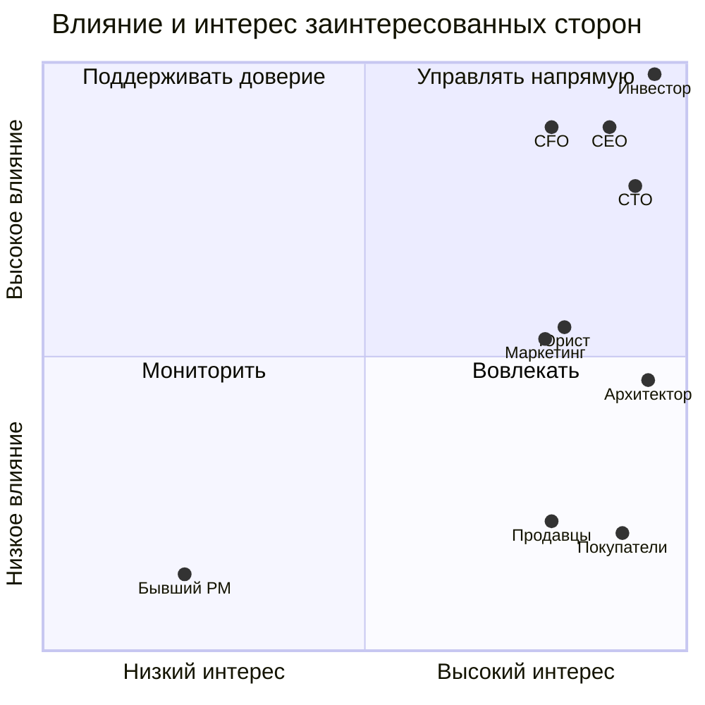

# Матрица стейкхолдеров — Africa Delivery

**Срез решения:** 12 августа 2026 (старт работы архитектора). **Статус:** предложение к встрече в Найроби, не согласовано. Влияние/интерес: высокий (В), средний (С), низкий (Н). Приоритет означает **право согласования в своей области**, а не произвольное ранжирование людей.

| Стейкхолдер | Интерес и позиция | Влияние / интерес | Приоритет при конфликте и границы полномочий | Коммуникация |
|---|---|---|---|---|
| **К. Орлов, инвестор** | Запуск **15.10**, продажи, 40% рынка за 3 года, отсутствие простоев, данные в стране, выплаты продавцам в тот же день | В / В | **1 — бизнес-арбитр** для цены, сроков, публичных обещаний и принятого риска; **не отменяет закон и договорные ограничения** | Одностраничная записка: решение, альтернатива, цена отказа; очное согласование в Найроби |
| **Марк Лефевр, CEO** | Реализуемый MVP и операционный запуск в двух странах | В / В | **2 — владелец продукта и go/no-go**, эскалация инвестору при несовместимых обязательствах | Ежедневный риск/решение, итоговая матрица приоритетов |
| **Анна Вебер, CFO** | Runway 9 мес.; техрасходы **≤$5 000/мес.** первые 6 мес.; максимум 6 контракторов; комиссия PSP <2,5% GMV | В / В | **Финансовое вето**: письменное согласование каждой позиции >$500/мес.; без новых бюджетных строк | Таблица TCO, поштучная стоимость заказа, альтернативы и счета |
| **Раджеш Менон, CTO** | 10 млн пользователей с первого дня; Kubernetes/микросервисы/Oracle, RPO=0, multicloud | В / В | **Техническое решение** после проверки стоимости, требований и срока; спор о перерасходе — CFO/CEO | ADR с измеряемыми критериями, техревью |
| **София Алмейда, маркетинг** | Неизменяемая оплаченная кампания $180 000, обещания доставки/возврата/языков, app stores к 01.10 | С / В | Влияет на обещания, **не утверждает легальность рассылок или реальную готовность сервиса** | Реестр обещаний и еженедельные go/no-go проверки |
| **Адаезе Нвосу, внешний юрист** | Локализация и трансграничная обработка данных, согласия, лицензии, подделки | С / В | **Правовой gate**: заключение предварительное; окончательные требования — с локальными консультантами | Письменные вопросы по странам/категориям данных и юридическое заключение |
| **Solution Architect (мы)** | Проверяемость архитектуры и обратимость решения | С / В | Рекомендует компромисс и ADR; **не утверждает бюджет, законность или бизнес-обещания** | Canvas, конфликт-реестр, краткий доклад CTO/CEO |
| **Том Брэдли, бывший PM** | 29 функций «все P0» | Н / Н | Не действующий утверждающий; список — источник гипотез, а не baseline | Через архивированный перечень функций |
| **Покупатели, продавцы, логистические и платёжные партнёры** | Доступность заказа, безопасная оплата, доставка и расчёты | Н / В | Не представлены в штате; легальность и возможность интеграции нельзя заменить мнением инвестора | Интервью/проверка договоров и SLA, владельцем назначения выступает CEO |

**Отрендеренная диаграмма:** [stakeholder-influence-interest.svg](stakeholder-influence-interest.svg). SVG воспроизводит координаты Mermaid-диаграммы выше.

**Правило эскалации:** инвестор/CEO решают о сокращении публичного scope и бизнес-риске; CFO — о расходах; юрист — о правомерности (окончательная юридическая оценка вне полномочий команды); CTO — об исполнимой архитектуре. При конфликте этих ограничений **не объявлять согласование автоматически состоявшимся**.

## Assumptions

- Координаты квадрантов, относительное влияние маркетинга/юриста и назначенные формы коммуникации — **экспертная оценка**, а не данные интервью.
- CEO временно исполняет роль Product Owner до найма замены PM; инвестор арбитр публичных обещаний, но не юридических разрешений.
- Покупателей, продавцов и операционных партнёров необходимо представить на discovery; в компании нет сотрудника с локального рынка.

**Источники:** [input_data/company-structure.md](../input_data/company-structure.md); [input_data/meeting-investor.md](../input_data/meeting-investor.md); [input_data/letter-cfo.md](../input_data/letter-cfo.md); [input_data/letter-cto.md](../input_data/letter-cto.md); [input_data/marketing-brief.md](../input_data/marketing-brief.md); [input_data/lawyer-letter.md](../input_data/lawyer-letter.md); [input_data/list-of-functions-product-manager.md](../input_data/list-of-functions-product-manager.md).

## Ответственность по всем 28 записям

## Полная трассировка 28 записей исходного аудита

**Источник:** [requirements-traceability.md](../input_data/requirements-traceability.md). Эта таблица — **классификация Task1**, а не изменение исходных данных. «Конфликт» означает несовместимые обязательства в одном релизе; «риск/напряжение» требует проверки; «пробел» означает отсутствующий сценарий; «ошибка документации» исправляется без бизнес-арбитража.

| ID | Класс в Task1 | Предмет | Владелец | Обработка и решение |
|---|---|---|---|---|
| [R-01](../input_data/requirements-traceability.md) | Ошибка документации | Ошибка TCO-лимита | CFO; архитектор | Исправить TCO; $5 000/мес. включает тех-SaaS |
| [R-02](../input_data/requirements-traceability.md) | Конфликт требований | Ресурсный конфликт CTO/CFO | CFO; CTO; CEO | C-01: TCO и штатный лимит до ADR |
| [R-03](../input_data/requirements-traceability.md) | Неопределённость | Разные прогнозы и единицы нагрузки | CTO; маркетинг; CEO | Q-05: MAU, покупатели, RPS, стресс-сценарии |
| [R-04](../input_data/requirements-traceability.md) | Неопределённость | Два последовательных срока, не логический конфликт | CEO; маркетинг | Q-01: gate публикации 01.10 и запуска 15.10 |
| [R-05](../input_data/requirements-traceability.md) | Конфликт требований | Полный список P0 против ограниченного MVP | CEO; инвестор | C-02: подписанный MVP scope |
| [R-06](../input_data/requirements-traceability.md) | Конфликт требований | Микросервисный подход против ресурсов | CTO; CFO | C-01: количественное сравнение архитектур |
| [R-07](../input_data/requirements-traceability.md) | Конфликт требований | Self-hosted по умолчанию против CN.MSV.01 | CTO | C-08: исключения для managed-сервисов |
| [R-08](../input_data/requirements-traceability.md) | Неопределённость | Запрет синхронности строже CN.LCP.05; не взаимоисключение | CTO | ADR-001: выбрать стиль API, уточнить CNCF-цель |
| [R-09](../input_data/requirements-traceability.md) | Напряжение / риск | SLO/стоимость не доказаны, не логически несовместимы | CTO; CFO | Q-05: оценить error budget и TCO |
| [R-10](../input_data/requirements-traceability.md) | Неопределённость | Предварительная правовая трактовка | Юрист | Q-04: legal gate и консервативная локализация |
| [R-11](../input_data/requirements-traceability.md) | Напряжение / риск | Маркетинговая рассылка без подтверждённого правового основания | Юрист; маркетинг | C-05: приостановить до legal sign-off |
| [R-12](../input_data/requirements-traceability.md) | Конфликт требований | Публичные методы оплаты шире MVP | CEO; CFO; юрист | C-07: PSP матрица и публичные обещания |
| [R-13](../input_data/requirements-traceability.md) | Пробел требований | Нет settlement в MVP при требовании same-day | CFO; Product | C-07: проверить выплату по договорам PSP |
| [R-14](../input_data/requirements-traceability.md) | Конфликт требований | Собственный движок 6 мес. против MVP 8 недель | CEO; CTO | C-06: partner-first для MVP |
| [R-15](../input_data/requirements-traceability.md) | Конфликт требований | Возвраты к запуску против плана на год | CEO; маркетинг | C-03: возвраты или пересмотр обещания |
| [R-16](../input_data/requirements-traceability.md) | Конфликт требований | Пять языков к запуску против года | CEO; маркетинг | C-04: согласовать языковой scope |
| [R-17](../input_data/requirements-traceability.md) | Ошибка документации | 60%/100% мобильного трафика без разграничения | Product; архитектор | Уточнить статистику рынка и проектный канал |
| [R-18](../input_data/requirements-traceability.md) | Пробел требований | USSD/SMS охват без MVP-флоу заказа | CEO; Product | C-09: scope USSD и договор оператора |
| [R-19](../input_data/requirements-traceability.md) | Напряжение / риск | Простая регистрация совместима с KYC, но бейдж требует доказательств | Product; Compliance | C-10: gate верификации до бейджа |
| [R-20](../input_data/requirements-traceability.md) | Ошибка документации | 12–15 всего vs +15 в схеме | Maintainer | Исправить формулировку в схеме |
| [R-21](../input_data/requirements-traceability.md) | Ошибка документации | Отсутствие конкурентов vs Jumia/Takealot | CEO; маркетинг | Исправить вводное позиционирование |
| [R-22](../input_data/requirements-traceability.md) | Напряжение / риск | Высокое качество изображений vs 3G/<2 сек., требует измерения | CTO; Product | Performance budget и тесты |
| [R-23](../input_data/requirements-traceability.md) | Пробел требований | Live-stream 17.10 без описанной реализации | CEO; маркетинг | Go/no-go партнёрского стриминга |
| [R-24](../input_data/requirements-traceability.md) | Ошибка документации | Некорректные пути и имена файлов | Maintainer | Исправить ссылки/названия |
| [R-25](../input_data/requirements-traceability.md) | Статус исполнения | Статус артефактов на момент первичного аудита | Maintainer | Task1 создан; Task2–5 проверить отдельно |
| [R-26](../input_data/requirements-traceability.md) | Пробел требований | Cloud Native без матрицы тестов | CTO; DevOps | Task3: контроль CN.* → проверка |
| [R-27](../input_data/requirements-traceability.md) | Ошибка документации | OpenSLO и этапы перехода неоднозначны | Maintainer | Уточнить формат и шестимесячный этап |
| [R-28](../input_data/requirements-traceability.md) | Неопределённость | $12k/мин — гипотеза инвестора, не P&L | CFO; инвестор | TCO чувствительность; не смешивать GMV и прибыль |

**Сводка:** конфликты — 8; риски/напряжения — 4; неопределённости — 5; пробелы — 4; ошибки документации — 6; статус — 1. Все 28 ID представлены ровно по одному разу.

**Разделение полномочий:** CEO и инвестор согласуют бизнес-обязательства, CFO — расходные лимиты, CTO — архитектуру в утверждённых рамках, юрист — правовые основания, маркетинг — рекламные обещания, maintainer — исправления спецификации. Ни один участник не может единолично снять все ограничения.

