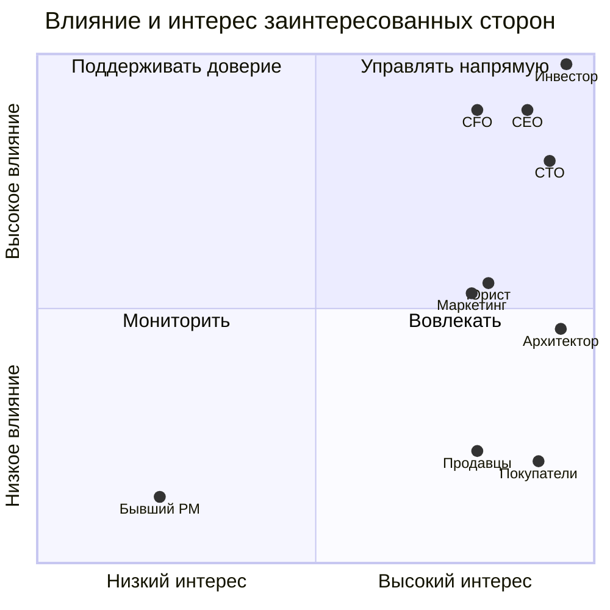

# Матрица стейкхолдеров — Africa Delivery

**Срез решения:** 12 августа 2026 (старт работы архитектора). **Статус:** предложение к встрече в Найроби, не согласовано. Влияние/интерес: высокий (В), средний (С), низкий (Н). Приоритет означает **право согласования в своей области**, а не произвольное ранжирование людей.

| Стейкхолдер | Интерес и позиция | Влияние / интерес | Приоритет при конфликте и границы полномочий | Коммуникация |
|---|---|---|---|---|
| **К. Орлов, инвестор** | Запуск **15.10**, продажи, 40% рынка за 3 года, отсутствие простоев, данные в стране, выплаты продавцам в тот же день | В / В | **1 — бизнес-арбитр** для цены, сроков, публичных обещаний и принятого риска; **не отменяет закон и договорные ограничения** | Одностраничная записка: решение, альтернатива, цена отказа; очное согласование в Найроби |
| **Мартин Лефевр, CEO** | Реализуемый MVP и операционный запуск в двух странах | В / В | **2 — владелец продукта и go/no-go**, эскалация инвестору при несовместимых обязательствах | Ежедневный риск/решение, итоговая матрица приоритетов |
| **Анна Вебер, CFO** | Runway 9 мес.; техрасходы **≤$5 000/мес.** первые 6 мес.; максимум 6 контракторов; комиссия PSP <2,5% GMV | В / В | **Финансовое вето**: письменное согласование каждой позиции >$500/мес.; без новых бюджетных строк | Таблица TCO, поштучная стоимость заказа, альтернативы и счета |
| **Раджеш Менон, CTO** | 10 млн пользователей с первого дня; Kubernetes/микросервисы/Oracle, RPO=0, multicloud | В / В | **Техническое решение** после проверки стоимости, требований и срока; спор о перерасходе — CFO/CEO | ADR с измеряемыми критериями, техревью |
| **София Алмейда, маркетинг** | Неизменяемая оплаченная кампания $180 000, обещания доставки/возврата/языков, app stores к 01.10 | С / В | Влияет на обещания, **не утверждает легальность рассылок или реальную готовность сервиса** | Реестр обещаний и еженедельные go/no-go проверки |
| **Адаезе Нвосу, внешний юрист** | Локализация и трансграничная обработка данных, согласия, лицензии, подделки | С / В | **Правовой gate**: заключение предварительное; окончательные требования — с локальными консультантами | Письменные вопросы по странам/категориям данных и юридическое заключение |
| **Solution Architect (мы)** | Проверяемость архитектуры и обратимость решения | С / В | Рекомендует компромисс и ADR; **не утверждает бюджет, законность или бизнес-обещания** | Canvas, конфликт-реестр, краткий доклад CTO/CEO |
| **Том Брэдли, бывший PM** | 29 функций «все P0» | Н / Н | Не действующий утверждающий; список — источник гипотез, а не baseline | Через архивированный перечень функций |
| **Покупатели, продавцы, логистические и платёжные партнёры** | Доступность заказа, безопасная оплата, доставка и расчёты | Н / В | Не представлены в штате; легальность и возможность интеграции нельзя заменить мнением инвестора | Интервью/проверка договоров и SLA, владельцем назначения выступает CEO |

**Правило эскалации:** инвестор/CEO решают о сокращении публичного scope и бизнес-риске; CFO — о расходах; юрист — о правомерности (окончательная юридическая оценка вне полномочий команды); CTO — об исполнимой архитектуре. При конфликте этих ограничений **не объявлять согласование автоматически состоявшимся**.

## Допущения

- Координаты квадрантов, относительное влияние маркетинга/юриста и назначенные формы коммуникации — **экспертная оценка**, а не данные интервью.
- CEO временно исполняет роль Product Owner до найма замены PM; инвестор арбитр публичных обещаний, но не юридических разрешений.
- Покупателей, продавцов и операционных партнёров необходимо представить на discovery; в компании нет сотрудника с локального рынка.

**Источники:** [input_data/company-structure.md](../input_data/company-structure.md); [input_data/meeting-investor.md](../input_data/meeting-investor.md); [input_data/letter-cfo.md](../input_data/letter-cfo.md); [input_data/letter-cto.md](../input_data/letter-cto.md); [input_data/marketing-brief.md](../input_data/marketing-brief.md); [input_data/lawyer-letter.md](../input_data/lawyer-letter.md); [input_data/list-of-functions-product-manager.md](../input_data/list-of-functions-product-manager.md).

**Разделение полномочий:** CEO и инвестор согласуют бизнес-обязательства, CFO — расходные лимиты, CTO — архитектуру в утверждённых рамках, юрист — правовые основания, маркетинг — рекламные обещания, maintainer — исправления спецификации. Ни один участник не может единолично снять все ограничения.

