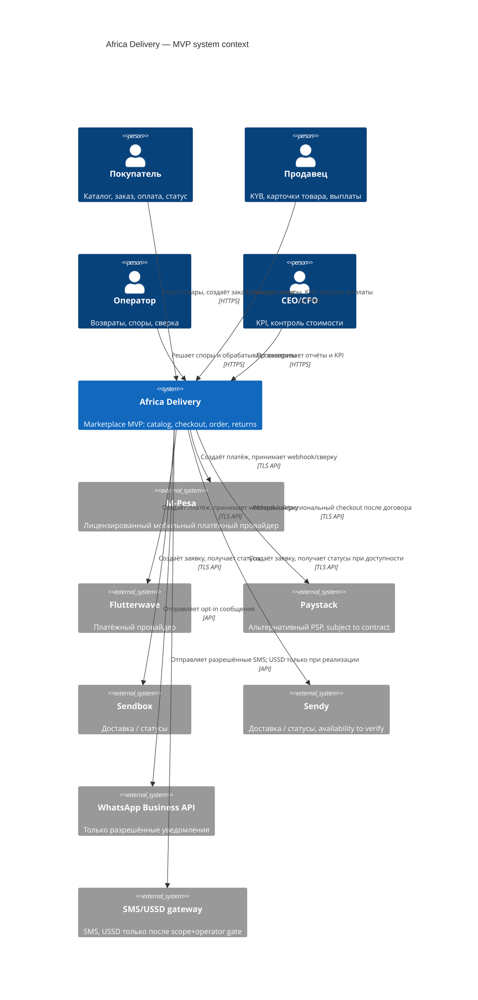

# C4 Context — Africa Delivery

**Уровень:** C4 System Context; Mermaid C4Context; внешние системы не подразумевают подписанные договоры. Country/data границы требуют Task4 legal gate. Потоки оплат не проходят через собственный лицензированный процессинг: PSP — system of record.

**Системные границы:** M-Pesa/Flutterwave/Paystack, Sendbox/Sendy, WhatsApp Business API и SMS/USSD — **внешние интеграции, не микросервисы MVP**; включение провайдера зависит от country-method-cost-legal gate. Source: [ADR-001](adr-001-architecture-style.md); [Task1](../Task1/contradictions.md).
