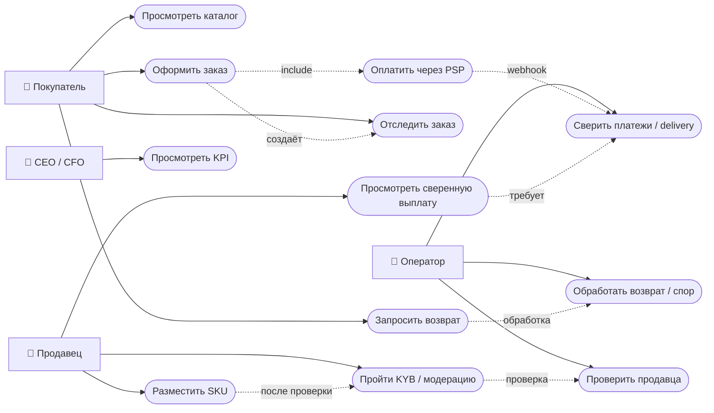

# Use Case Diagram — MVP Africa Delivery

**Mermaid:** Mermaid flowchart как use-case representation (в Mermaid нет нативного UML use-case DSL); овалы имитируют прецеденты. Сплошные связи — участие роли; пунктирные — include/dependency. Не все рекламные обещания реализованы.

## Сценарии и допуски
| UC | Основной результат | Приёмка / отказ |
|---|---|---|
| UC-01 Catalog | SKU найден и показан на дешёвом Android/3G | бюджет изображений, тест p75 first-item <2s как целевое значение, не гарантия |
| UC-02 Checkout | уникальный заказ, idempotency key, валидные товары | при тайм-ауте PSP статус pending, не двойное списание |
| UC-03 Pay | событие от лицензированного PSP, сверка | подтверждён метод×страна×fee <2,5% GMV; подпись webhook |
| UC-04 Shipping | заявка в партнёрскую доставку, статус | подтверждён договор, регион покрытия, SLA |
| UC-05 Seller | onboarding + KYB; бейдж только верифицированному | без KYB нет утверждения verified |
| UC-06 Returns | операторский запрос/решение/refund | политика, согласие PSP и юриста; «мгновенно» не обещать без SLA |
| UC-07 Messaging | opt-in транзакционное уведомление | закупленные 410k номеров не импортировать |
| UC-08 KPI | агрегаты регистраций/заказов/GMV | фактическое запаздывание/сверка, без ложной «realtime» точности |

**Не входит без отдельного sign-off:** USSD checkout, live-shopping, 5 проверенных локализаций, собственный движок доставки, wallet, ML, blockchain. Связанные требования: Task1 C-02/03/04/05/06/07/09/10.
