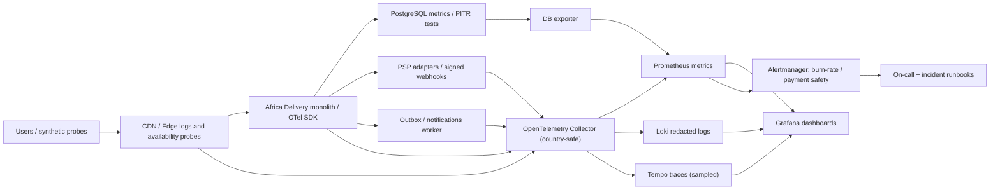

# Наблюдаемость и инцидент-реакция — Africa Delivery

**Статус:** проектная конфигурация, инструменты **рекомендованы**, а не фактически установлены. Исходный стиль — модульный монолит ([ADR-001](../Task2/adr-001-architecture-style.md)); лимит тех-SaaS ≤$5k/мес. первые 6 месяцев. Четыре золотых сигнала считаются по catalog, checkout/payment и notifications/outbox, с измеримыми SLI из [контрактов](slo/catalog.md).

## Четыре золотых сигнала и связь с SLI

| Сигнал | Пример метрик с ограниченными labels | СLI/бизнес-смысл | Alert |
|---|---|---|---|
| **Latency** | `http_server_duration_seconds_bucket{route,method,country,component}`, `payment_intent_duration_seconds`, `outbox_enqueue_to_ack_seconds` | Catalog good≤1s; Checkout intent good≤3s; notifications ACK≤5min | p99 catalog>1s 10min; p99 internal checkout>3s 5min |
| **Traffic** | `http_requests_total{route,country,status_class}`, `checkout_attempts_total`, `outbox_eligible_total` | Denominator good/eligible; estimate RPS vs capacity, align with marketing scenario | 2× tested RPS sustained 5min; queue ingress>drain |
| **Errors** | `http_requests_total{outcome}`, `payment_false_success_total`, `psp_webhook_invalid_total`, `notification_dlq_total` | Catalog/Payment error budget; financial safety invariants | financial duplicate or false success **immediate Sev1**; multiwindow burn 14.4× |
| **Saturation** | `db_pool_in_use/max`, `cpu_utilization`, `worker_backlog_oldest_seconds`, `pod_restart_total`, `cdn_cache_hit_ratio` | Leading indicators for 99.9% SLO misses | DB pool>85% 10min, outbox oldest>10min for 5min |

Counter **definition**: collect edge-origin traffic to avoid missing app outages; use OpenTelemetry HTTP server middleware for latency histogram, but **edge requests as denominator**. `good` counters instrument HTTP correctness plus required data semantics, not simply status <500. Instrument consent-safe gateway ACK with provider ID after durable outbox. PSP end-to-end terminal latency measured from persisted intent to reconciled terminal state; 15min timeout monitored. Separate NG/KE and partner; never put user IDs, transaction IDs or phone numbers in metric labels.

## Telemetry architecture (Mermaid)

Telemetry destinations/regions **are conditional upon Task4 local counsel approval**; default no cross-border PII/log exporting. Named products are examples of OSS components, subject to cost, security and operational review; *no requirement to deploy full Jaeger+Loki+Kafka+Istio at MVP*.

## Instrumentation and sampling
- Every inbound request receives trace context (W3C Trace Context); propagate traceparent over HTTP and via `traceparent` metadata in outbox. Trace spans: edge → catalog/order module → DB → adapter call → webhook reconcile → worker. Correlate `trace_id` in redacted structured logs; **trace IDs** not high-cardinality metric labels.
- Server traces: parent-based head-sampling 5% baseline, **100% retained errors where the collector supports tail sampling** (otherwise report observed bias); financial events always audited in immutable, permissioned journal **not** by retaining every trace.
- JSON logs: UTC timestamp, route template, country, sanitized outcome, duration, trace ID, partner alias, severity; omit PAN, tokens, mobile numbers, raw addresses, PII and payloads. Retention proposed logs 14 days, traces 7 days, aggregated SLI 90 days **subject to legal and finance review**, not a decided legal retention period.
- Metrics retention 90 days where feasible; low-cardinality labels limited to route template, country, payment provider, status class. Partner-sensitive commercial figures separate secure BI.
- Synthetic probes: catalog every minute from approved country network, checkout PSP sandbox every 5 min (no real charges), notification canary every 5 min to consented test recipient. Synthetic probes must **not** inflate customer financial KPIs.

## Alerting, SLO and runbooks
**Sev1:** false-positive paid state, duplicate confirmed payment, unauthorized PII transfer, checkout unavailable >2min in country. Page on-call immediately; freeze deployments; CFO/Security/Legal escalation for money/data incidents. **Sev2:** catalog hard outage >5min, outbox backlog age>10min continuously 5min, burning >50% monthly budget by day 15. **Sev3:** isolated latency, cache hit ratio below trial target with no SLA impact. Use two independent signals (SLI + synthetic) to reduce alert fatigue; no alerting based solely on a 200 status.
**Burn:** alerts for 99.9% 30-day window: 14.4× over 1h+5m, 6× over 6h+30m. Policies for 99.0% notification calculated with own 1% error budget. Error budget exhaustion → pause noncritical deploys, CTO review and backlog paydown; don't silently amend denominator or exclude PSP faults.
**Runbooks:** [FMEA](fmea.md) FM-01 DB down restore / kill switches, FM-02 PSP unknown state → pending and reconciliation, FM-03 partner delivery down → manual fallback, FM-04 SMS down → outbox retained, FM-08 backup restore; postmortem ≤2 working days for Sev1, corrective plan in 5.

## Verification and operating cost
Before production, run staging faults (Toxiproxy for PSP/SMS, kill app, DB failover), verify alerts within 5min, trace consistency and no PII leak, test replayed webhooks/outbox, audit alert routing. Expenses for telemetry storage, sampling, retention and on-call count toward $5k technical infrastructure/SaaS cap; no invented vendor quotes or implied CFO approval. Controls map to [NFR-17](nfr-registry.md) and Task1 R-07/R-08/R-09/R-10/R-26.
