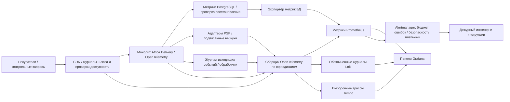

# Наблюдаемость и инцидент-реакция — Africa Delivery

**Статус:** проектная конфигурация, инструменты **рекомендованы**, а не фактически установлены. Исходный стиль — модульный монолит ([ADR-001](../Task2/adr-001-architecture-style.md)); лимит тех-SaaS ≤$5k/мес. первые 6 месяцев. Четыре золотых сигнала считаются по каталогу, оформлению и оплате заказа, уведомлениям и очереди событий, с измеримыми SLI из [контрактов](slo/catalog.md).

## Четыре золотых сигнала и связь с SLI

| Сигнал | Примеры метрик с ограниченным числом меток | Связь с SLI и бизнесом | Условие оповещения |
|---|---|---|---|
| **Задержка** | `http_server_duration_seconds_bucket{route,method,country,component}`, `payment_intent_duration_seconds`, `outbox_enqueue_to_ack_seconds` | Каталог: корректный ответ ≤1 с; оформление: сохранение намерения ≤3 с; уведомления: приём шлюзом ≤5 мин | p99 каталога >1 с в течение 10 мин; p99 оформления >3 с в течение 5 мин |
| **Трафик** | `http_requests_total{route,country,status_class}`, `checkout_attempts_total`, `outbox_eligible_total` | Знаменатель SLI, число запросов в секунду и сопоставление с испытанной мощностью | Нагрузка выше удвоенной испытанной в течение 5 мин; приток очереди больше обработки |
| **Ошибки** | `http_requests_total{outcome}`, `payment_false_success_total`, `psp_webhook_invalid_total`, `notification_dlq_total` | Бюджет ошибок каталога и оплаты; контроль финансовой целостности | Повторное списание или ложный успех — немедленный критический инцидент; расход бюджета >14,4× |
| **Насыщение** | `db_pool_in_use/max`, `cpu_utilization`, `worker_backlog_oldest_seconds`, `pod_restart_total`, `cdn_cache_hit_ratio` | Ранние признаки нарушения цели 99,9% | Пул БД >85% в течение 10 мин; возраст события >10 мин в течение 5 мин |

**Правило подсчёта:** знаменатель берётся с пограничного шлюза, чтобы учитывать недоступность приложения. OpenTelemetry собирает гистограммы задержек. Счётчик успешных операций проверяет код HTTP и смысл ответа, а не только отсутствие 5xx. Для уведомлений учитывается подтверждение шлюза после надёжного сохранения события; для платежей — время до сверенного конечного статуса. Страны и провайдеры разделяются по меткам; номера телефонов, идентификаторы пользователей и платежей не используются как метки.

## Архитектура сбора телеметрии (Mermaid)

Регионы хранения телеметрии утверждаются только после заключений местных юристов в Task4; трансграничная передача персональных данных и журналов по умолчанию запрещена. Названные инструменты — варианты свободного ПО, а не обязательство развернуть весь стек Jaeger, Loki, Kafka и Istio для MVP.

## Инструментирование и выборка
- Каждый входящий запрос получает контекст трассировки W3C; поле `traceparent` передаётся по HTTP и в метаданных очереди событий. Участки трассы: шлюз → каталог/заказ → БД → партнёрский адаптер → сверка вебхука → обработчик. Поле `trace_id` связывает обезличенные журналы; его нельзя использовать как метку метрики.
- Трассировка: исходная выборка 5% запросов с наследованием решения от родителя; при поддержке выборки по результату сохранять все ошибочные трассы. Финансовые события всегда отражать в защищённом неизменяемом журнале, а не полагаться на выборочную трассировку.
- Структурированные журналы JSON: время UTC, шаблон маршрута, страна, обезличенный результат, длительность, идентификатор трассы, провайдер и уровень события. Не сохранять номера карт, токены, телефоны, адреса и персональные данные. Предлагаемые сроки: журналы 14 дней, трассы 7 дней, агрегированные SLI 90 дней; сроки требуют согласования юристов и CFO.
- Метрики хранить до 90 дней при допустимой стоимости. Метки ограничить шаблоном маршрута, страной, провайдером и классом статуса. Коммерческие сведения партнёров хранить отдельно с ограниченным доступом.
- Контрольные запросы: каталог каждую минуту из разрешённой сети; оформление в тестовой среде PSP каждые 5 минут без настоящих списаний; тестовое уведомление каждые 5 минут согласившемуся адресату. Контрольные операции не должны увеличивать финансовые показатели.

## Оповещения, SLO и инструкции дежурного
**Критический инцидент (Sev1):** ложная оплата, повторное списание, неразрешённая передача данных или недоступность оформления >2 минут в стране. Немедленно вызвать дежурного, остановить развёртывания и привлечь CFO, безопасность и юристов. **Значительный инцидент (Sev2):** каталог недоступен >5 минут, возраст очереди >10 минут в течение 5 минут или более половины месячного бюджета ошибок израсходовано к 15-му дню. **Незначительный инцидент (Sev3):** отдельные задержки или падение доли попаданий в кеш без нарушения SLO. Использовать SLI и контрольные запросы вместе, а не один код 200.
**Скорость расходования бюджета ошибок:** для цели 99,9% за 30 суток оповещать при 14,4× за 1 час и 5 минут либо 6× за 6 часов и 30 минут. Для уведомлений с целью 99,0% использовать собственный бюджет 1%. При исчерпании приостановить необязательные выпуски, провести разбор CTO; не изменять знаменатель задним числом и не скрывать отказы PSP.
**Инструкции дежурного:** [FMEA](fmea.md) FM-01 — отказ БД и восстановление; FM-02 — неопределённый статус PSP и сверка; FM-03 — ручная обработка доставки; FM-04 — сохранение очереди при отказе SMS; FM-08 — восстановление копий. Критический инцидент разобрать за 2 рабочих дня, план исправления — за 5.

## Проверка и эксплуатационные расходы
Перед эксплуатацией испытать сбои PSP/SMS через Toxiproxy, остановку приложения и переключение БД; проверить оповещения ≤5 минут, связь трасс, отсутствие утечек и повторную обработку вебхуков. Хранение телеметрии и дежурство учитываются в техническом лимите $5 000/мес. Тарифы поставщиков и согласование CFO не подтверждены. Соответствие: [NFR-17](nfr-registry.md), Task1 R-07/R-08/R-09/R-10/R-26.
