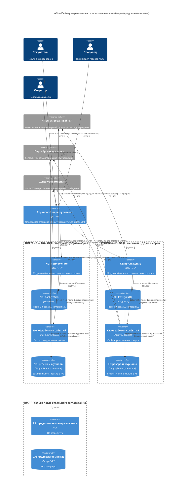

# Диаграмма C4 Container — страновые контуры Africa Delivery

**Статус:** проектная структура, а не утверждённые/развёрнутые кластеры. Mermaid C4Container; каждый контейнер подписан по стране. NG и KE используют одну кодовую базу модульного монолита, но **отдельные хранилища и ключи**. Будущий ZA-контур показан как неактивный. Конкретные местные поставщики NG/KE не выбраны.

**Пояснения:** C4 Container — логические исполняемые части; «страна» — граница развёртывания, а не доказательство независимых центров обработки данных. Маршрутизатор не должен хранить запросы/PII в третьей стране. Статический каталог может публиковаться в CDN после проверки данных; персональные объекты не кешируются общим CDN (ADR-002). Подписи связей обязательны. См. [ADR-003](adr-003-data-residency.md), [схему развёртывания](deployment-diagram.md).
