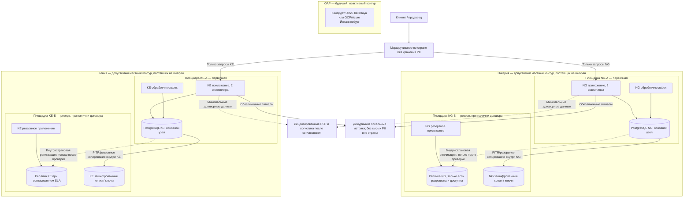

# Deployment Diagram — размещение и границы переключения

**Формат:** Mermaid `flowchart` с развёртыванием по странам и физически независимыми площадками только как **целевыми**, не приобретёнными. Для NG/KE локальные поставщики и второй ЦОД **не подтверждены**. Монолит — один код в двух раздельных страновых развертываниях. Стрелки миграции данных через границу страны отсутствуют намеренно.

**Режим отказа:** NG-А → NG-Б или KE-А → KE-Б **только после** подтверждения второго местного ЦОД, непрерывной репликации, fencing прежнего primary и проверки расхождений PSP. **Не переключать** NG в KE/ЮАР и KE в NG/ЮАР по умолчанию. При отсутствии второго местного ЦОД — остановка создания заказов и безопасное восстановление на разрешённой площадке. См. [failover-plan.md](failover-plan.md).
