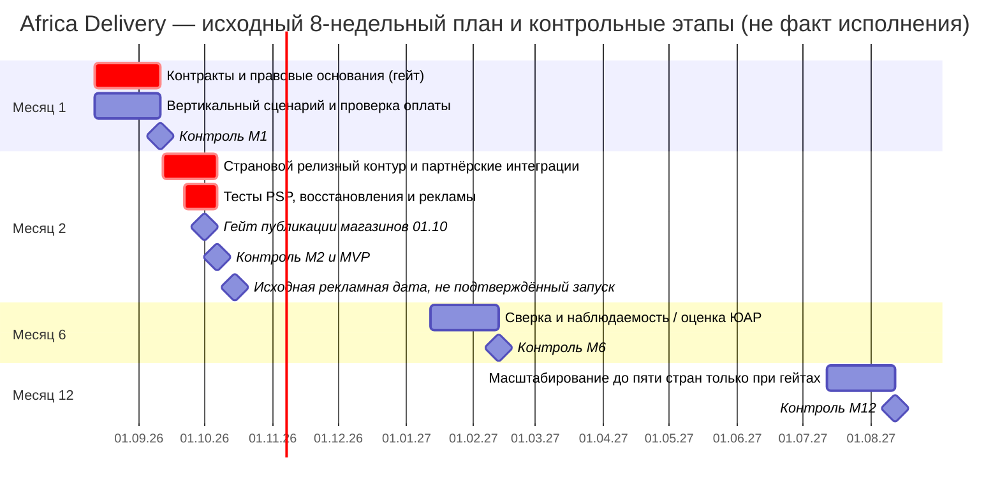

# Дорожная карта MVP — Africa Delivery

**Дата составления:** 19.10.2026. **Статус:** реконструкция восьминедельного плана, не отчёт о выполнении: дата первоначального запуска **15.10.2026 уже прошла**, подтверждённых поставок нет. T0 условно = 12.08.2026; 8 недель = 07.10.2026, до рекламной даты ещё 8 суток, но размещение страниц магазинов к 01.10.2026 требует готовности раньше. **Без закрытия правовых, коммерческих и рекламных противоречий исходный запуск не доказан и должен получить решение no-go.**

## 1. Четыре контрольные точки

| Контрольная точка | Содержание и результат | Команда | Регулярная инфраструктура и тех-SaaS | Условие допуска |
|---|---|---|---|---|
| **Месяц 1 (12.08–11.09, контроль 11.09)** | Исполняемый вертикальный сценарий каталог → заказ → имитатор PSP; первичная проверка продавцов, idempotency, код адаптеров, оценка регионов; договорный пакет PSP/ЦОД | 6 контракторов, в том числе 1 техлид, 2 backend, 1 frontend, 1 интеграции/QA, 1 инфраструктура/безопасность | **$1 800/мес. условно**, неполная среда; отдельные позиции >$500 согласуются CFO | Демонстрация тестового заказа, обработка отказа PSP, проект legal/data flow |
| **Месяц 2 / MVP (12.09–07.10, контроль 07.10; плановый релиз 15.10 — отдельный gate)** | Каталог и простой поиск, корзина, один доказанный PSP-метод на страну, партнёрская доставка, ручные возвраты, уведомления с разрешением, KYB и минимальная панель операций, сверка платежей | **Те же 6**, не добавлять людей без финансирования | **$4 800/мес.** как сценарная сумма Task2 с двумя локальными контурами, включая $2 200/мес. условного дополнительного размещения; резерв лишь $200 до потолка **$5 000/мес.**, фактические котировки отсутствуют | Местные поставщики и резервы, PSP комиссия <2,5% GMV, SLA доставки/возвратов, подписанные исключения рекламы, нагрузочные тесты, публикация магазина |
| **Месяц 6 (около 12.02.2027)** | Измеренные метрики оплаты и конверсии, автоматизация сверки, тесты восстановления, второй партнёр по необходимости, подготовка ЮАР | 6 до разрешения найма, при расширении — новая финансовая модель | **$3 200/мес. сценарий**, превышение $5 000 в первые полгода недопустимо; после шестого месяца бюджет отдельно утверждается | Подтверждённая финансовая модель и local legal gate |
| **Месяц 12 (около 12.08.2027)** | Гипотеза до 5 стран, локализация по спросу, выборочное выделение модулей только при нагрузке, не 40 сервисов по умолчанию | Штат **не определён**; сценарий ≥9 FTE только после согласования | **$4 200/мес. сценарий**, не действующее разрешение | Положительная экономика страны, независимый правовой/PSP/логистический gate для каждой страны |

**Финансовая сноска:** $1 800/$4 800/$3 200/$4 200 — *плановые допущения*; суммарная инфраструктура двух локализованных стран из [Task4](../Task4/cloud-regions-comparison.md) пока не оценена договорами. Поэтому отметка «в пределах $5 000» не может быть выдана как доказанный факт. Сумма ФОТ отдельно: 6 × $3 500 = **$21 000/мес.** модель Task2; он не входит в инфраструктурный лимит. Предоплата и обязательства свыше горизонта runway запрещены.

## 2. Полная классификация 29 функций PM

**Правило отбора:** функция участвует непосредственно в проверяемом сквозном заказе и законном расчёте, помещается в бюджет/штат, имеет договорные и правовые основания и обязательные инварианты целостности. «В MVP частично» — не означает, что обещанная PM полная функция исполнена. **Итог: 6 из 29 — частичный минимальный срез, 0 — полное исполнение исходного расширенного P0, 23 — перенесены.** В MVP также появляются обязательные компоненты, отсутствующие как отдельные номера PM (согласия, платёжная сверка, надежность, журнал аудита).

| № PM | Исходное требование (кратко) | Решение MVP / что включено и что исключено | Следующий gate |
|---:|---|---|---|
| **1** | Неограниченный каталог и категории | **Частично:** ограниченный каталог до ~5 тыс. SKU с простыми категориями, без «неограниченного» | Нагрузка и управление схемами |
| 2 | Полнотекстовый поиск с ошибками на 5 языках | **Отложено**; в MVP допускаются простой поиск/фильтры как часть C02, **без** заявленной многоязычной функции | Статистика запросов, локализация |
| 3 | Голосовой поиск | Отложено | Исследование спроса и речи |
| 4 | ИИ-рекомендации | Отложено | Данные и доказанная конверсия |
| 5 | Live-покупки с чатом | Отложено; обещание 17.10 — **блокер рекламы** | CEO/инвестор, партнёр стриминга |
| 6 | Чат с переводом | Отложено | ROI и согласия |
| 7 | Фото-/видеоотзывы | Отложено | Модерация и хранилище |
| 8 | Онбординг через WhatsApp | Отложено; MVP веб-форма продавца | Договор API и KYB |
| 9 | Онбординг через USSD | Отложено | Оператор, проверка личности |
| 10 | Расширенная аналитика продавца | Отложено; минимальная информация о заказах в MVP вне полного пункта PM | Транзакционные данные |
| **11** | Все PSP, карты, перевод, наличные | **Частично:** один законный подписанный метод **по стране**, без обещания полного набора | [ADR-004](adr-004-payment-provider.md) |
| 12 | Рассрочка/скоринг | Отложено | Финансовые лицензии |
| 13 | Мультивалютный кошелёк | Отложено | Лицензии и KYC |
| 14 | Криптотокены | Отложено | Регулирование и экономика |
| 15 | Колесо наград | Отложено | Экономика маркетинга |
| 16 | Флеш-продажи и резервы | Отложено как отдельная механика; базовое резервирование заказа входит в C03 | Управление остатками |
| 17 | Динамические цены по Jumia | Отложено | Правовая оценка и рентабельность |
| **18** | Живая карта курьера, ETA до минуты | **Частично:** базовые статусы заказа и доставки, без live-карты и ETA до минуты | API партнёра и SLA |
| 19 | ПВЗ и видеофиксация | Отложено | Договор пунктов выдачи, законность записи |
| **20** | Бесплатный возврат 30 дней и мгновенный refund | **Частично:** операторский запрос/ручной процесс с PSP; 30 дней/мгновенность **не обещать без подписанного SLA** | CEO/Legal и договор PSP, маркетинг |
| 21 | ML-антифрод | Отложено; базовые правила и ручная сверка отдельно от ML | Данные и потери от фрода |
| 22 | B2B | Отложено | B2B экономика |
| 23 | Реферальная программа | Отложено | Конверсия и право |
| 24 | Полный USSD/SMS-заказ | Отложено, SMS-уведомление **не является** USSD-заказом; конфликт R-18 | Контракт оператора и scope sign-off |
| 25 | PWA + нативные iOS и Android | Отложен **полный паритет трёх клиентов**; узкий адаптивный веб-интерфейс MVP вне исходного пункта | Подтверждение App Store-гейта и платформ |
| **26** | Полный бэк-офис | **Частично:** модерация продавца, заказов, возвратов и сверка; без полной CMS | Показатели нагрузки операторов |
| 27 | Публичный GraphQL | Отложено | API-стратегия и внешние клиенты |
| **28** | Живой дашборд руководства | **Частично:** базовые агрегированные KPI с задержкой до 1 минуты при легальной агрегации | Точность, задержка, data residency |
| 29 | Тёмная тема | Отложено | Пользовательские исследования |

**Материалы инвестора:** клиентский путь, юридическая чистота и договорный settlement обязательны, но маркетинговые обещания о языках, возврате, доставке, продаже live и USSD **не считаются согласованно отложенными**. Отсутствие подписи CEO/инвестора → **no-go** соответствующих рынков/кампании, даже при готовом коде.

## 3. Реальные ресурсы и ограничения сроков
В первом грубом расчёте [Capability Map](capability-map.md) оценено 44 человеко-недели работ при 48 номинальных; 4 недели резерва (**8,3%**), чего недостаточно. Для реального плана необходимо снять минимум 8 человеко-недель (например, расширенный поиск, панель KPI и автоматизацию возвратов), получить новый backlog 36 человеко-недель и резерв 12 недель (25%) при неизменной безопасности и финансовой целостности не покрывают полноценные тесты, отказы, правовые блокеры, коммуникации, релиз и поддержку. Поэтому roadmap — **условный агрессивный план**, а не утверждение, что любой набор реализуем. Разрешено сокращать поиск, аналитику, автоматизацию; запрещено сокращать целостность платежа, юрисдикцию, consent, контроль резервных копий и договорные gates.

**Go/no-go:** подписанные договоры PSP/логистики с комиссиями и SLA, письма юристов, договоры ЦОД в NG/KE, испытанный RTO/RPO, клиентский запуск с корректным описанием scope и подтверждением рекламы, согласованный бюджет. Без доказательств — пересогласовать дату. **Нельзя обещать исторический запуск 15 октября 2026 задним числом.**

## 4. Командная схема и эксплуатация
Работа: [организация команды и 24×7](team-operating-model.md). Выбран **удалённый формат с обязательными короткими сессиями в Найроби и местными рабочими контактами**, поскольку наём заморожен и не выделен бюджет под постоянный офис. Шесть контракторов не обеспечивают устойчивое 24×7 без оплаченного on-call и резервов. Если бизнес требует круглосуточного SLA с момента запуска, CFO/CEO должны подписать внешнее дежурство или отказаться от такого SLA до подтверждения ресурса.
