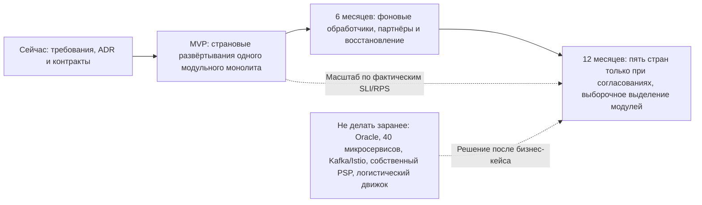

# Переходная архитектура — сейчас → MVP → 6 месяцев → 12 месяцев

**Статус:** проектное эволюционное направление, а не подтверждение запуска. Даты 01.10.2026 и 15.10.2026 были исходными точками кейса и на дату подготовки 19.10 уже прошли. Переписывание платформы не предполагается: сохраняются модульный монолит [ADR-001](../Task2/adr-001-architecture-style.md), кеширование [ADR-002](../Task3/adr-002-caching-strategy.md), страновая изоляция [ADR-003](../Task4/adr-003-data-residency.md) и платежные порты [ADR-004](adr-004-payment-provider.md).

## Состояния

| Измерение | Сейчас: анализ, нет подтверждения запуска | MVP — 2-й месяц от утверждённого старта | 6 месяцев | 12 месяцев |
|---|---|---|---|---|
| Рынки | NG и KE — кандидаты, legal/PSP gates открыты | До двух стран **только после отдельного go/no-go** | Закрепить NG/KE, готовить ZA после правовой проверки | Целевая гипотеза до **пяти стран**, не обязательство |
| Прикладная архитектура | Требования и ADR | Модульный монолит с модулями Catalog, Seller/KYB, Order, Payment, Fulfillment, Returns, Notifications | Отделить фоновых работников, улучшить релизы и автоматику | Выделять сервис лишь при реальной нагрузке/разных требованиях масштабирования |
| Данные | Страновые провайдеры NG/KE не закуплены | Независимые страновые БД, ключи, журналы и резервные копии по решению Task4 | Реплика и DR внутри юрисдикции только после подтверждённого договора | Дополнительные контуры по стране; экспорт только после законного основания |
| Платежи | Нет утверждённого PSP и комиссии | Страновой партнёр и один метод, подтверждённый договором | Второй PSP только при экономике/надёжности | Выделение платёжного домена или оркестрации после подтверждённого спроса и права |
| Доставка | Нет заключённых SLA | Партнёрская доставка, статусы, ручная обработка исключений | Улучшить интеграции и возвраты | Рассмотреть собственный движок при TCO+нагрузке |
| Команда | 6 контракторов, найм заморожен | 6 контракторов: единая мультифункциональная команда | Расширение только после CFO и новой финансовой модели | Независимые команды только при бюджете |
| Качество | SLO проектные, не проверены | Каталог/намерение оплаты 99,9%, уведомления 99,0% как тестовые цели | Проверенный RTO/RPO, улучшенные инструменты реагирования | Цели 99,95/99,99 пересмотреть по стоимости отказа |

## Путь без переписывания системы

**Стабильные контракты:** `country` в контексте заказа, `OrderId`, идемпотентность API, внешние адаптеры PSP/Delivery/Notifications, доменные события с версией, outbox и аудируемые миграции PostgreSQL. Для выделения домена: (1) определить границы данных и SLA, (2) настроить публикацию событий и shadow reads, (3) миграция только разрешённых данных, (4) включить маршрут по feature flag, (5) сверить денежные и доставочные события, (6) откатить при ошибке; **никакой неконтролируемой cross-country репликации**.

**Триггеры извлечения:** два последовательных месяца насыщения DB или p95 checkout выше Task3 NFR после оптимизации; выделение отдельного домена снижает TCO; команда ≥9 FTE с новым бюджетом; правовые требования изолируют контур. Без этих условий выделение в сервисы не производится.

## Критические остановки
Недоказанная комиссия PSP <2,5% GMV, отсутствие местных договоров по данным, неразрешённая покупная SMS-база, неизвестные сроки seller settlement и доставки, несогласованные рекламные обещания и отсутствие 24×7 модели — **не технические улучшения после запуска**, а условия допуска. Если не решены, пересогласовать фактическую дату; не выдавать прошедший 15.10.2026 за будущую.
