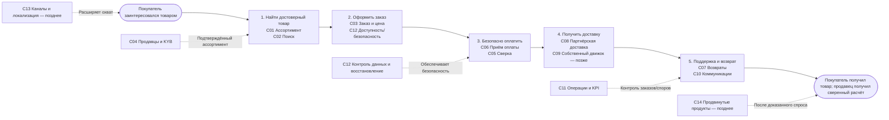

# Поток создания ценности (Value Stream) — Africa Delivery

**Ценность:** покупатель получает подтверждённый заказ, продавец — подтверждённый расчёт, оператор — управляемые исключения. Каждая возможность C01–C14 определена в [Capability Map](capability-map.md), ни один этап не подменяет расчёт с PSP или логистикой.

## Результаты и измерения этапов

| Этап | Выход для следующего | Capability | Проверка успеха | Основной риск |
|---|---|---|---|---|
| Обнаружение | Проверенная карточка и цена | C01–C02, C04 | p99 каталога ≤1 с как испытательная цель; карточка проверенного продавца | Ложная верификация |
| Конверсия | Заказ и зафиксированная цена | C03, C12 | Идемпотентный заказ, без дублей | Неверный остаток |
| Оплата | PSP подтверждение/ожидание + сверка | C05–C06 | Без ложного «оплачено»; комиссия <2,5% GMV лишь по подписанному тарифу | PSP и лицензирование |
| Исполнение | Статус партнёра и получатель | C08, C10 | Только покрытые зоны и согласованные SLA | Недоступность партнёра |
| Поддержка и возврат | Решение оператора + refund PSP | C07, C11 | Отслеживаемый возврат, заявленные сроки по PSP | Несовпадение с рекламой |

**Границы:** ручные возвраты, уведомления только с правовым основанием, отдельная зона NG/KE, а не трансграничная общая БД. В будущих периодах добавить C09/C13/C14 только после финансовых и юридических gates. См. [ADR-004](adr-004-payment-provider.md).
