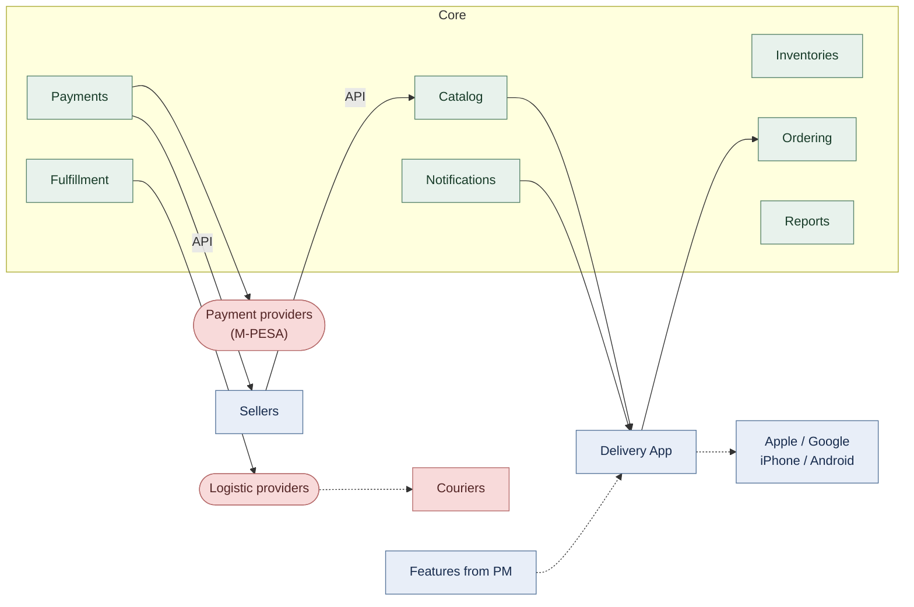

# Схема

# Дополнительные параметры из схемы
| Параметр | Значение |
|----------|----------|
| География	| Nigeria, Kenya, South Africa, +15 стран | 
| Целевая доля рынка |	40% |
| Архитектура |	Cloud Native |
| Платформы | iOS, Android |
| Защита данных | GDPR |
| TCO |	Не определён |
| Функциональность | Features from PM |
